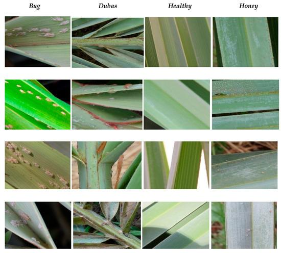
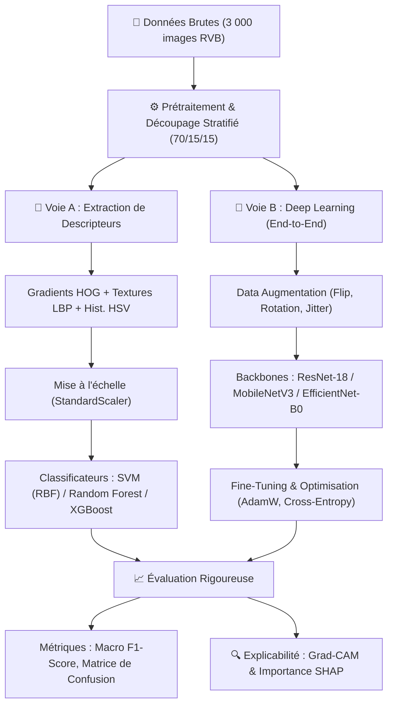

# 🌴 Classification Automatisée des Feuilles de Palmier Dattier Infestées par le Dubas (*Ommatissus lybicus*)

<div align="center">

[](https://www.python.org/)
[](https://pytorch.org/)
[](https://scikit-learn.org/)
[](https://opencv.org/)
[](https://data.mendeley.com/datasets/2nh364p2bc/2)
[](https://doi.org/10.1016/j.dib.2023.109371)
[](LICENSE)

**Projet Universitaire de Recherche & Ingénierie en Vision par Ordinateur**  
*Étude comparative entre apprentissage automatique classique (Machine Learning) et apprentissage profond (Deep Learning) pour l'agriculture de précision.*

<br/>



*Figure 1 : Aperçu global des folioles de palmier dattier (*Phoenix dactylifera*) selon les différents stades d'infestation par le dubas.*

</div>

---

## 📌 Sommaire

- [1. Présentation & Contexte Agronomique](#-1-présentation--contexte-agronomique)
- [2. Audit Technique du Jeu de Données](#-2-audit-technique-du-jeu-de-données)
  - [Corrections des informations et organisation réelle](#a-organisation-physique-et-correspondance-des-classes)
  - [Répartition statistique](#b-statistiques-et-distribution-des-classes)
  - [Galerie visuelle des 4 classes](#c-galerie-visuelle-des-quatre-classes)
- [3. Architecture du Projet & Pipeline de Traitement](#-3-architecture-du-projet--pipeline-de-traitement)
  - [Structure du dépôt](#a-arborescence-du-projet)
  - [Pipeline méthodologique de bout en bout](#b-pipeline-méthodologique)
- [4. Stratégie d'Extraction de Caractéristiques](#-4-stratégie-dextraction-de-caractéristiques)
- [5. Modélisation : Approches ML & Deep Learning](#-5-modélisation--approches-ml--deep-learning)
- [6. Protocole Expérimental & Métriques d'Évaluation](#-6-protocole-expérimental--métriques-dévaluation)
- [7. Intelligence Artificielle Explicable (XAI)](#-7-intelligence-artificielle-explicable-xai)
- [8. Guide d'Installation & Démarrage Rapide](#-8-guide-dinstallation--démarrage-rapide)
- [9. Références Scientifiques & Citation](#-9-références-scientifiques--citation)

---

## 🔬 1. Présentation & Contexte Agronomique

Le palmier dattier (*Phoenix dactylifera*) constitue l'épine dorsale de l'agriculture oasienne et de l'économie fruitière dans la région MENA (Moyen-Orient et Afrique du Nord). Cependant, cette culture fait face à une menace phytosanitaire majeure : l'insecte **Dubas** (*Ommatissus lybicus* Bergevin / *Ommatissus binotatus lybicus*).

### 🐛 La Problématique Biologique
- **Dégâts directs** : Les nymphes et les adultes piquent les folioles (palmes) et sucent la sève élaborée, entraînant un affaiblissement progressif de l'arbre, le jaunissement foliaire et une baisse drastique de la qualité des dattes.
- **Dégâts indirects** : L'insecte exsude d'importantes quantités de liquide sucré et visqueux (**le miellat**). Ce substrat favorise la prolifération de champignons noirs saprophytes (**la fumagine**), formant une pellicule opaque qui bloque l'interception de la lumière solaire et asphyxie la photosynthèse.

<div align="center">
  <blockquote>
    <b>🎯 Défi scientifique :</b> L'inspection visuelle manuelle des cimes de palmiers (dépassant souvent 10 à 15 mètres de hauteur) est lente, coûteuse et physiquement dangereuse. L'objectif de ce projet est de concevoir un système automatisé de vision par ordinateur, capable de discriminer avec précision les folioles saines, la présence d'insectes, le miellat et les infestations mixtes, à partir d'images haute résolution capturées par capteurs ou drones.
  </blockquote>
</div>

---

## 📊 2. Audit Technique du Jeu de Données

Le jeu de données officiel a été collecté dans des vergers de palmiers de la région d'Aoun (Gouvernorat de Kerbala, Irak) et documenté dans la revue internationale *Data in Brief* (Elsevier, 2023).

### A. Organisation Physique et Correspondance des Classes

> [!IMPORTANT]
> **Clarification technique essentielle (Correction des fausses informations) :**  
> L'archive d'origine présente un nommage de dossiers qu'il convient d'interpréter rigoureusement pour éviter toute erreur d'étiquetage lors de l'entraînement (*Label Mapping*) :

| Nom du dossier sur disque | Préfixe des fichiers | Classe sémantique réelle | Description biologique |
| :--- | :--- | :--- | :--- |
| `Healthy/` | `Healthy(x).jpg` | **Saine (Healthy)** | Folioles intactes, tissu vert uniforme, absence de parasite. |
| `Bug/` | `Bug(x).JPG` | **Insectes Dubas (Bug)** | Présence visible de nymphes ou adultes de dubas sans nappe massive de miellat. |
| `Honey/` | `Honey(x).jpg` | **Miellat (Honey)** | Dépôts collants et gouttelettes de miellat sécrétés sur la surface foliaire. |
| `Dubas/` *(attention)* | `Mixed(x).jpg` | **Infestation Mixte (Mixed)** | Coexistence d'insectes vivants et de sécrétions de miellat sur la même foliole. |

### B. Statistiques et Distribution des Classes

Un audit systématique par script Python a validé l'intégrité de l'ensemble des fichiers :
- **Nombre total d'images :** 3 000
- **Images corrompues ou illisibles :** 0
- **Espace colorimétrique :** 100 % RVB (3 canaux, 8-bit par canal)
- **Résolution native :** $896 \times 896$ pixels (majorité absolue, avec de rares variantes conformes à $892 \times 892$ et $1792 \times 1792$)

```
Distribution globale du jeu de données :
├── Saines (Healthy)          : 800 images (26.67 %)
├── Miellat (Honey)           : 800 images (26.67 %)
├── Infestation Mixte (Mixed) : 800 images (26.67 %)
└── Insectes Dubas (Bug)      : 600 images (20.00 %)
TOTAL                         : 3 000 images
```

<div align="center">
  
  <p><em>Figure 2 : Répartition des classes. Le jeu de données est quasi-équilibré, avec un léger déséquilibre maîtrisé sur la classe Bug (ratio 1:1.33).</em></p>
</div>

### C. Galerie Visuelle des Quatre Classes

Chaque catégorie possède une signature visuelle spécifique capturée en haute définition :

<div align="center">
  
  <p><em>Figure 3 : Exemples visuels représentatifs issus directement du jeu de données (résolution native de 896 × 896 px).</em></p>
</div>

1. **Feuille Saine (`Healthy`)** : Nervures longitudinales régulières, couleur verte homogène sans taches chlorotiques ni exsudats.
2. **Insectes Dubas (`Bug`)** : Présence ponctuelle de petits corps d'insectes (stades larvaires ou adultes jaunâtres/brunâtres) le long de la nervure.
3. **Miellat (`Honey`)** : Zones brillantes, aspect translucide à vitreux sous la lumière, dépôts liquides créant des reflets spéculaires.
4. **Infestation Mixte (`Mixed / Dubas`)** : Cumul de dépôts visqueux étendus et d'agrégats d'insectes, stade le plus sévère de l'attaque parasitaire.

---

## 🛠️ 3. Architecture du Projet & Pipeline de Traitement

### A. Arborescence du Projet

```text
projet ML/
│
├── README.md                                     # Documentation académique et guide technique
├── requirements.txt                              # Dépendances Python (PyTorch, scikit-learn, etc.)
├── generale.jpg                                  # Photographie scientifique de référence
│
├── assets/                                       # Ressources graphiques et visualisations générées
│   ├── class_distribution.png                    # Graphique de répartition des classes
│   ├── dataset_samples.png                       # Échantillons haute résolution des 4 classes
│   ├── feature_extraction_preview.png            # Visualisation des descripteurs de caractéristiques
│   ├── ml_architecture.png                       # Schéma de l'architecture complète du pipeline
│   └── generale.jpg                              # Copie miroir de l'image de synthèse
│
└── Image dataset of infected date palm leaves/   # Répertoire racine du jeu de données
    └── Image dataset of infected date palm leaves by dubas insects/
        └── Palm Leaves Dataset/
            ├── Bug/                              # 600 images - Insectes seuls (Bug(1).JPG ...)
            ├── Dubas/                            # 800 images - Infestation mixte (Mixed(1).jpg ...)
            ├── Healthy/                          # 800 images - Feuilles saines (Healthy(1).jpg ...)
            └── Honey/                            # 800 images - Miellat sécrété (Honey(1).jpg ...)
```

### B. Pipeline Méthodologique

Le projet adopte une architecture modulaire à deux voies complémentaires : l'une basée sur l'ingénierie de caractéristiques artisanales couplée à des modèles statistiques légers, l'autre exploitant des réseaux de neurones profonds par apprentissage par transfert (*Transfer Learning*).

<div align="center">
  
  <p><em>Figure 4 : Pipeline complet de traitement des données, de l'ingestion à l'explicabilité (XAI).</em></p>
</div>



---

## 🔍 4. Stratégie d'Extraction de Caractéristiques

Pour l'approche en apprentissage automatique classique, les images brutes ne peuvent être injectées directement sans une étape d'ingénierie d'attributs visuels ciblés :

<div align="center">
  
  <p><em>Figure 5 : Analyse multi-spectrale et spatiale sur une foliole atteinte : Image RVB originale, gradients de texture (Sobel), segmentation colorimétrique HSV du miellat, et profils d'histogrammes RVB.</em></p>
</div>

1. **Histogrammes de Couleur (Espaces HSV & Lab)** :
   - *Intérêt :* Le miellat et la décoloration chlorotique modifient la saturation ($S$) et la composante chromatique ($a^*, b^*$).
   - *Usage :* Vecteur de 32 bins par canal pour quantifier la perte de verdeur.
2. **Histogrammes de Gradients Orientés (HOG - *Histogram of Oriented Gradients*)** :
   - *Intérêt :* Détection des contours nets, des formes oblongues des insectes dubas et des gouttelettes en relief.
3. **Motifs Binaires Locaux (LBP - *Local Binary Patterns*)** :
   - *Intérêt :* Invariant aux variations d'éclairage, parfait pour caractériser la rugosité de la surface foliaire et la texture fine de la fumagine.
4. **Plongements Pré-entraînés (*Deep Embeddings*)** :
   - *Intérêt :* Utilisation des couches intermédiaires d'un réseau convolutif gelé (ex. ResNet-18 sans sa tête de classification) pour extraire un vecteur compact de 512 caractéristiques latentes.

---

## ⚡ 5. Modélisation : Approches ML & Deep Learning

Le tableau suivant synthétise l'évaluation académique des 8 algorithmes envisagés pour la tâche de classification à 4 classes :

| Famille | Algorithme | Caractéristiques d'entrée | Atouts majeurs | Limites / Compromis | Recommandation |
| :--- | :--- | :--- | :--- | :--- | :---: |
| **ML Classique** | **SVM (Noyau RBF)** | HOG + LBP + HSV (standardisés) | Excellente frontière de décision en grande dimension | Coût quadratique si grand volume | ⭐⭐⭐⭐ (Solide baseline) |
| **ML Classique** | **Random Forest** | Descripteurs concaténés | Robuste au bruit, résistant au surapprentissage | Moins sensible aux détails de texture subtils | ⭐⭐⭐⭐ (Robuste) |
| **ML Classique** | **XGBoost** | Descripteurs concaténés | Gradient boosting ultra-performant sur données tabulaires | Réglage délicat des hyperparamètres | ⭐⭐⭐⭐ (Très performant) |
| **ML Classique** | **K-NN ($k=5$)** | Plongements normalisés | Simple, sans phase d'entraînement explicite | Lenteur à l'inférence, sensible aux dimensions | ⭐⭐ (Pédagogique) |
| **Deep Learning** | **MobileNetV3-Small** | Images RVB ($224 \times 224$) | Ultra-léger (~2.5M params), taillé pour drones & IoT | Précision légèrement inférieure aux modèles lourds | ⭐⭐⭐⭐⭐ (Idéal Déploiement) |
| **Deep Learning** | **ResNet-18** | Images RVB ($224 \times 224$) | Blocs résiduels stables, convergence rapide | Capacité limitée sur détails microscopiques | ⭐⭐⭐⭐⭐ (Équilibre Idéal) |
| **Deep Learning** | **EfficientNet-B0** | Images RVB ($224 \times 224$) | Échelonnage composé optimal (Compound Scaling) | Consommation mémoire plus élevée lors du fine-tuning | ⭐⭐⭐⭐⭐ (Haute Précision) |
| **Deep Learning** | **CNN "From Scratch"** | Images RVB ($224 \times 224$) | Totalement personnalisable | Risque élevé de surapprentissage sur 3 000 images | ⭐⭐⭐ (Académique) |

---

## 🎯 6. Protocole Expérimental & Métriques d'Évaluation

### A. Découpage et Validation
- **Partitionnement Stratifié :** 70 % Apprentissage (2 100 images), 15 % Validation (450 images), 15 % Test (450 images).
- **Validation Croisée :** Stratified $k$-fold ($k=5$) pour fiabiliser l'évaluation statistique des modèles classiques.
- **Politique Anti-Fuite (*Data Leakage*) :** Les transformations d'augmentation de données (flips horizontaux/verticaux, rotations légères $\pm 15^\circ$, variations photométriques) sont appliquées **exclusivement** sur le sous-ensemble d'entraînement.

### B. Justification du Choix des Métriques
Bien que l'exactitude globale (*Accuracy*) offre un indicateur immédiat, elle peut masquer des défaillances sur les classes minoritaires :

$$\text{Macro F1-Score} = \frac{1}{C} \sum_{i=1}^{C} \frac{2 \cdot \text{Precision}_i \cdot \text{Recall}_i}{\text{Precision}_i + \text{Recall}_i} \quad \text{avec } C = 4$$

> [!NOTE]
> Le **Macro F1-Score** accorde un poids identique à chaque classe sans privilégier les classes majoritaires. Il garantit que la classe **Bug** (600 images) est détectée avec la même rigueur que les autres classes (800 images chacune).

---

## 💡 7. Intelligence Artificielle Explicable (XAI)

Dans une application agronomique critique, un modèle ne peut être déployé comme une "boîte noire". Il est impératif de vérifier que la décision s'appuie sur de réels critères biologiques (présence de l'insecte ou de gouttelettes) et non sur des artefacts d'arrière-plan ou de luminosité.

- **Grad-CAM (*Gradient-weighted Class Activation Mapping*)** : Calcule les gradients des scores de classe par rapport aux cartes d'activation de la dernière couche convolutive pour générer une carte de chaleur superposée à l'image d'origine.
- **SHAP (*SHapley Additive exPlanations*)** : Utilisé pour les forêts aléatoires et XGBoost, quantifiant l'impact marginal de chaque descripteur (texture LBP vs composante de couleur $S$).

---

## 🚀 8. Guide d'Installation & Démarrage Rapide

### Prérequis
- Python 3.9 ou version supérieure
- Gestionnaire de paquets `pip` ou environnement `conda`

### 1. Installation des dépendances
```bash
# Cloner le dépôt ou naviguer dans le dossier du projet
cd "projet ML"

# Créer un environnement virtuel recommandé
python -m venv venv
venv\Scripts\activate      # Sur Windows
# source venv/bin/activate # Sur Linux/macOS

# Installer les dépendances certifiées
pip install -r requirements.txt
```

### 2. Chargement du Jeu de Données en Python (PyTorch)
Voici un exemple prêt à l'emploi gérant rigoureusement la correspondance des dossiers :

```python
import os
import torch
from torchvision import datasets, transforms
from torch.utils.data import DataLoader

# Chemin vers le dossier racine du dataset
DATASET_PATH = r"Image dataset of infected date palm leaves\Image dataset of infected date palm leaves by dubas insects\Palm Leaves Dataset"

# Transformations adaptées au Transfer Learning
data_transforms = transforms.Compose([
    transforms.Resize((224, 224)),
    transforms.RandomHorizontalFlip(),
    transforms.ToTensor(),
    transforms.Normalize(mean=[0.485, 0.456, 0.406], std=[0.229, 0.224, 0.225])
])

# Chargement automatique via ImageFolder
dataset = datasets.ImageFolder(root=DATASET_PATH, transform=data_transforms)

# Dictionnaire de correspondance propre
label_mapping = {
    'Bug': 'Insectes Dubas',
    'Dubas': 'Infestation Mixte (Mixed)',
    'Healthy': 'Feuille Saine',
    'Honey': 'Miellat Sécrété'
}

print(f"✅ Total d'images chargées : {len(dataset)}")
print(f"📁 Classes détectées : {dataset.class_to_idx}")
for folder_name, idx in dataset.class_to_idx.items():
    print(f"   [{idx}] Dossier '{folder_name}' -> Classe : {label_mapping.get(folder_name, folder_name)}")
```

---

## 📚 9. Références Scientifiques & Citation

Si vous exploitez ce projet ou ce jeu de données dans le cadre de vos travaux universitaires ou publications, merci de citer les sources officielles :

```bibtex
@article{al2023image,
  title={Image dataset of infected date palm leaves by dubas insects},
  author={Al-Mahmood, Abdullah Mazin and Shahadi, Haider Ismael and Khayeat, Ali Retha Hasoon},
  journal={Data in Brief},
  volume={49},
  pages={109371},
  year={2023},
  publisher={Elsevier},
  doi={10.1016/j.dib.2023.109371}
}

@dataset{mazin2023dubas_mendeley,
  title={Image dataset of infected date palm leaves by dubas insects},
  author={Mazin, Abdullah and Almayaly, Haider},
  year={2023},
  publisher={Mendeley Data},
  version={2},
  doi={10.17632/2nh364p2bc.2}
}
```

---

<div align="center">
  <sub>Projet universitaire réalisé dans le cadre des études en Intelligence Artificielle & Apprentissage Automatique.</sub><br/>
  <sub>Distribué sous licence MIT. Tous droits de recherche réservés aux auteurs des publications d'origine.</sub>
</div>
