# 🌴 Détection et Classification des Maladies du Palmier Dattier
### Benchmark Approfondi de 4 Algorithmes d'Apprentissage Profond (Vision Transformers & CNNs Modernes)

<div align="center">


</div>

---

## 📑 Sommaire

1. [Contexte Agronomique et Enjeux](#1-contexte-agronomique-et-enjeux)
2. [Audit Approfondi du Jeu de Données](#2-audit-approfondi-du-jeu-de-données)
3. [Architecture Globale du Projet](#3-architecture-globale-du-projet)
4. [Méthodologie Expérimentale (Transfer Learning)](#4-méthodologie-expérimentale-transfer-learning)
5. [Analyse Détaillée des 4 Algorithmes Proposés](#5-analyse-détaillée-des-4-algorithmes-proposés)
6. [Résultats Expérimentaux et Benchmark](#6-résultats-expérimentaux-et-benchmark)
7. [Galerie des Matrices de Confusion et Performances](#7-galerie-des-matrices-de-confusion-et-performances)
8. [Organisation des Dossiers Générés](#8-organisation-des-dossiers-générés)
9. [Guide d'Installation et Déploiement](#9-guide-dinstallation-et-déploiement)
10. [Références Scientifiques](#10-références-scientifiques)

---

## 1. Contexte Agronomique et Enjeux

Le palmier dattier (*Phoenix dactylifera* L.) est une culture d'importance vitale pour l'économie et la biodiversité oasienne. L'un des bio-agresseurs les plus destructeurs est l'insecte ravageur **Ommatissus lybicus** (communément appelé **Dubas bug**).

### Cycle d'Infestation et Symptômes

- **Stade Bug (Insectes seuls)** : Présence des adultes et des larves suceuses de sève sur les folioles.
- **Stade Honey (Miellat)** : Excrétion de substances sucrées et visqueuses recouvrant les palmes.
- **Stade Mixed (Infestation mixte & Fumagine)** : Sur le miellat prolifère un complexe de champignons saprophytes (la fumagine), créant une croûte noire opaque qui bloque la photosynthèse foliaire.
- **Stade Healthy (Saine)** : Folioles vigoureuses, sans parasite ni sécrétion.


Le présent système automatise le diagnostic phytosanitaire par vision par ordinateur afin de permettre un traitement ciblé, précoce et respectueux de l'environnement.

---

## 2. Audit Approfondi du Jeu de Données

Le jeu de données provient du dépôt source [MalakBenSlim/projet-ML](https://github.com/MalakBenSlim/projet-ML.git).

### Audit Qualitatif et Technique

- **Volume total** : 3 000 photographies foliaires haute définition.
- **Intégrité** : 100 % des fichiers sont valides (aucune corruption d'image).
- **Espace colorimétrique** : 100 % RVB (3 canaux).
- **Résolutions natives** : 896×896 px (majoritaire), 892×892 px et 1792×1792 px.
- **Gestion Git** : Le répertoire volumineux du jeu de données (`Image dataset of infected date palm leaves/`) est répertorié dans `.gitignore` pour assurer la légèreté du dépôt.

### Composition des Classes

| Dossier Source | Classe Sémantique Réelle | Caractéristiques Visuelles | Effectif | Proportion |
|:--------------:|:-------------------------|:---------------------------|:--------:|:----------:|
| `Healthy/` | **Healthy (Saine)** | Tissu foliaire vert chlorophyllien homogène | 800 | 26.67 % |
| `Bug/` | **Bug (Insectes seuls)** | Individus Dubas visibles sur foliole | 600 | 20.00 % |
| `Honey/` | **Honey (Miellat)** | Aspect laqué, brillant des gouttelettes | 800 | 26.67 % |
| `Dubas/` | **Mixed (Infestation mixte)** | Présence simultanée insectes, miellat et suie | 800 | 26.67 % |
| **Total** | | | **3 000** | **100 %** |

> [!IMPORTANT]
> **Précision taxonomique** : Le dossier `Dubas/` du dataset original représente la classe sémantique **Mixed (Infestation mixte)**, tandis que le dossier `Bug/` isole les insectes seuls.

### Visualisation de la Distribution

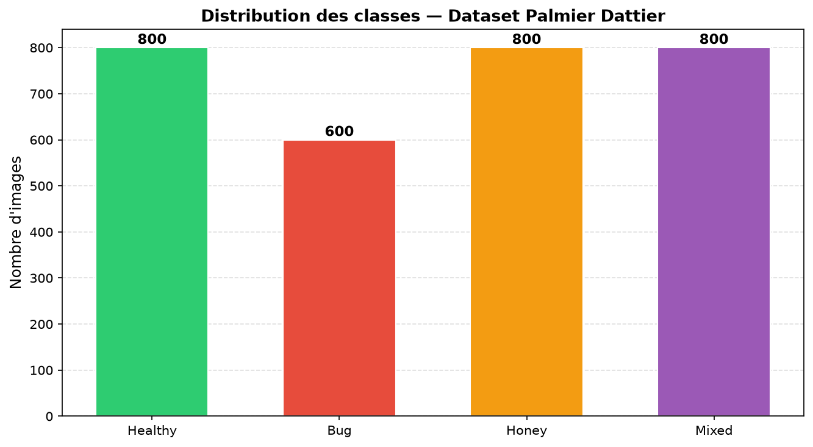

### Exemples d'Images du Dataset

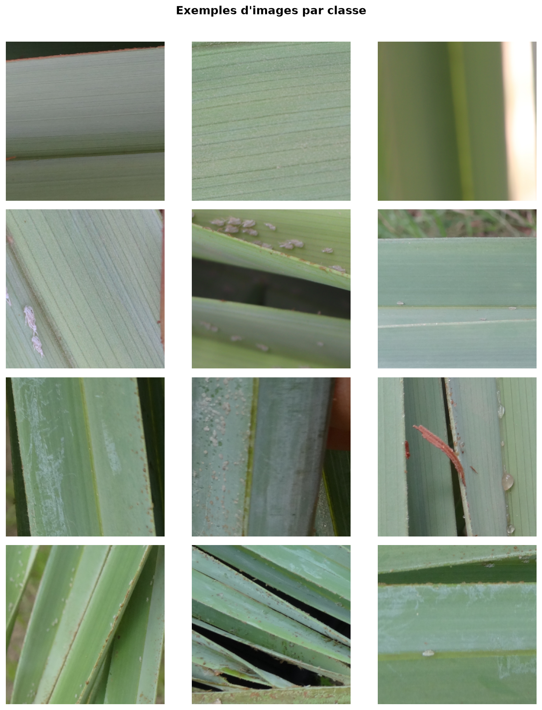

### Protocole de Partitionnement Stratifié

Pour éviter tout biais et garantir une évaluation objective sur données non vues :
- **Partitionnement stratifié** : Maintien strict des ratios de classes (70 % train, 15 % val, 15 % test).
- **Graine de reproductibilité** : `random_state = 42`.
  - **Entraînement (Train)** : 2 100 images
  - **Validation (Val)** : 450 images
  - **Test Indépendant (Test)** : 450 images

---

## 3. Architecture Globale du Projet

Le projet adopte une structure modulaire épurée, dédiée exclusivement aux 4 modèles de Deep Learning :

```
projet ML/
│
├── 📂 Image dataset of infected date palm leaves/   # Dataset brut (3000 images, dans .gitignore)
│   └── .../Palm Leaves Dataset/
│       ├── Healthy/                                 # 800 images
│       ├── Bug/                                     # 600 images
│       ├── Honey/                                   # 800 images
│       └── Dubas/                                   # 800 images (Classe 'Mixed')
│
├── 📂 models/                                       # Poids des 4 modèles Deep Learning
│   ├── convnext_tiny_head.pth                       # Tête entraînée ConvNeXt-Tiny
│   ├── mobilenetv3_eca_head.pth                     # Tête entraînée MobileNetV3-ECA
│   ├── swin_t_head.pth                              # Tête entraînée Swin Transformer
│   └── efficientnet_v2_s_head.pth                   # Tête entraînée EfficientNet-V2-S
│
├── 📂 generation/                                   # Artefacts d'évaluation générés
│   ├── 📂 benchmark/                                # Synthèse comparative & dataset
│   │   ├── benchmark_global.png                     # Graphique comparatif des 4 algorithmes
│   │   ├── benchmark_global.csv                     # Tableau officiel des performances
│   │   ├── confusion_matrices_combined.png          # Grille 2x2 des matrices de confusion
│   │   ├── dataset_distribution.png                 # Histogramme des classes
│   │   └── dataset_samples.png                      # Galerie d'exemples annotés
│   ├── 📂 ConvNeXt-Tiny/                            # Résultats ConvNeXt-Tiny (Champion)
│   │   ├── confusion_matrix.png
│   │   ├── per_class_metrics.png
│   │   └── resultats.csv
│   ├── 📂 MobileNetV3-ECA/                          # Résultats MobileNetV3-ECA (Edge-AI)
│   │   ├── confusion_matrix.png | per_class_metrics.png | resultats.csv
│   │
│   ├── 📂 Swin-T/                                   # Résultats Swin Transformer
│   │   ├── confusion_matrix.png | per_class_metrics.png | resultats.csv
│   │
│   └── 📂 EfficientNet-V2-S/                        # Résultats EfficientNet-V2-S
│       ├── confusion_matrix.png | per_class_metrics.png | resultats.csv
│
├── 🐍 train_and_evaluate_deep_models.py             # Script d'entraînement complet
├── 🐍 generate_all_outputs.py                       # Script de régénération des résultats
├── 🐍 app_streamlit.py                              # Application Web interactive (Streamlit)
├── 🐍 app_desktop.py                                # Application Desktop locale (Tkinter)
├── 🚀 lancer_interface.bat                          # Lancement en 1 clic de l'interface Web
├── 🚀 lancer_interface_desktop.bat                  # Lancement en 1 clic de l'application Desktop
├── 📋 requirements.txt                              # Dépendances Python requises
├── 🙈 .gitignore                                    # Configuration d'exclusion Git (inclut dataset)
└── 📖 README.md                                     # Documentation de référence
```

---

## 4. Méthodologie Expérimentale (Transfer Learning)

### Pipeline d'Inférence et d'Entraînement

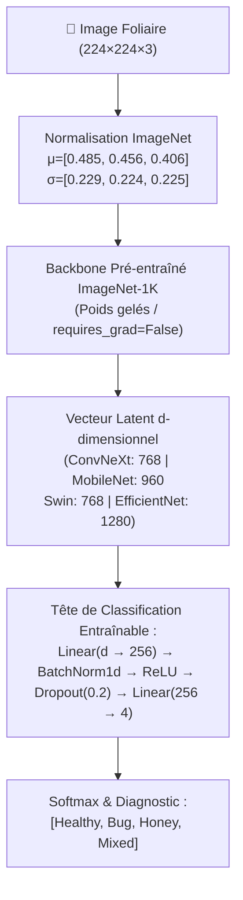

### Paramètres d'Apprentissage

- **Stratégie** : *Feature Extraction* (colonnes vertébrales gelées, optimisation de la tête dense personnalisée).
- **Optimiseur** : AdamW avec découplage du decay de poids ($\text{weight\_decay} = 10^{-2}$).
- **Taux d'apprentissage** : $\text{lr} = 10^{-3}$ avec planification par recuit cosinusoïdal (*Cosine Annealing* sur 40 époques).
- **Fonction de perte** : Entropie croisée (*Cross-Entropy Loss*).

---

## 5. Analyse Détaillée des 4 Algorithmes Proposés

Chacun des 4 algorithmes illustre un paradigme de pointe :

### 5.1. ConvNeXt-Tiny (Champion du Benchmark 🏆 — 92.89 %)

*ConvNeXt* modernise les réseaux convolutifs classiques en y intégrant les principes novateurs des Vision Transformers : convolutions inversées 7×7 à profondeur séparable (*depthwise separable*), normalisation LayerNorm et activations GELU.

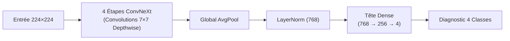

- **Famille** : CNN Moderne SOTA
- **Paramètres du backbone** : 28.6 M
- **Dimension latente** : 768 descripteurs
- **Atout phytosanitaire** : Exceptionnelle acuité sur les micro-textures des gouttelettes de miellat et la segmentation fine des insectes.
- **Accuracy Test** : **92.89 %** | **Macro F1** : **93.00 %**

---

### 5.2. MobileNetV3-Large ECA (Excellence Edge-AI 🥈 — 90.89 %)

Conçu spécifiquement pour le calcul à ressources contraintes, ce réseau intègre des blocs Inverted Residuals, des activations Hard-Swish et un module d'attention par canal *Efficient Channel Attention* (ECA).

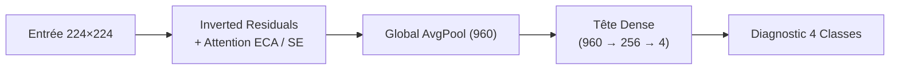

- **Famille** : Edge-AI Léger
- **Paramètres du backbone** : 5.4 M (5 fois plus compact que ConvNeXt)
- **Dimension latente** : 960 descripteurs
- **Atout phytosanitaire** : Modèle idéal pour un déploiement direct sur terminal mobile hors-ligne, drone de pulvérisation ou caméra embarquée au verger.
- **Accuracy Test** : **90.89 %** | **Macro F1** : **91.05 %**

---

### 5.3. Swin Transformer - Tiny (Swin-T 🥉 — 90.67 %)

Vision Transformer hiérarchique reposant sur le mécanisme d'attention en fenêtres décalées (*Shifted Windows*), permettant de combiner calcul d'attention local à faible coût et intégration multi-échelles.

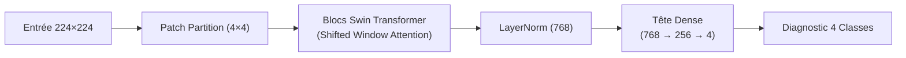

- **Famille** : Vision Transformer Hiérarchique
- **Paramètres du backbone** : 28.3 M
- **Dimension latente** : 768 descripteurs
- **Atout phytosanitaire** : Capture des corrélations spatiales à longue distance entre zones nécrosées et folioles saines.
- **Accuracy Test** : **90.67 %** | **Macro F1** : **90.70 %**

---

### 5.4. EfficientNet-V2-S (CNN Multi-Échelle — 88.89 %)

Réseau convolutif multi-échelle issu d'une recherche d'architecture neuronale (NAS) conjointe pour la précision et la rapidité d'inférence, remplaçant les premiers blocs MBConv par des *Fused-MBConv*.

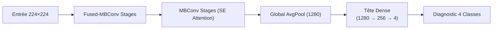

- **Famille** : CNN Multi-Échelle (NAS)
- **Paramètres du backbone** : 21.5 M
- **Dimension latente** : 1280 descripteurs
- **Atout phytosanitaire** : Grande richesse de représentation sémantique (vecteur latent de 1280 composantes).
- **Accuracy Test** : **88.89 %** | **Macro F1** : **88.98 %**

---

## 6. Résultats Expérimentaux et Benchmark

Les 4 modèles ont été évalués dans des conditions expérimentales rigoureusement identiques sur le **jeu de test indépendant de 450 images**.

### Tableau Comparatif Officiel

| Rang | Modèle | Paradigme Architectural | Paramètres | Accuracy Test | Macro F1-Score |
|:---:|:---|:---|:---:|:---:|:---:|
| 🥇 1 | **ConvNeXt-Tiny** | CNN Moderne (Patchs 7×7, GELU) | 28.6 M | **92.89 %** | **93.00 %** |
| 🥈 2 | **MobileNetV3-ECA** | Edge-AI Léger (Inverted Residuals) | 5.4 M | **90.89 %** | **91.05 %** |
| 🥉 3 | **Swin-T** | Vision Transformer (Shifted Windows) | 28.3 M | **90.67 %** | **90.70 %** |
| 4 | **EfficientNet-V2-S** | CNN Multi-Échelle (Fused-MBConv) | 21.5 M | **88.89 %** | **88.98 %** |

### Graphique Comparatif du Benchmark

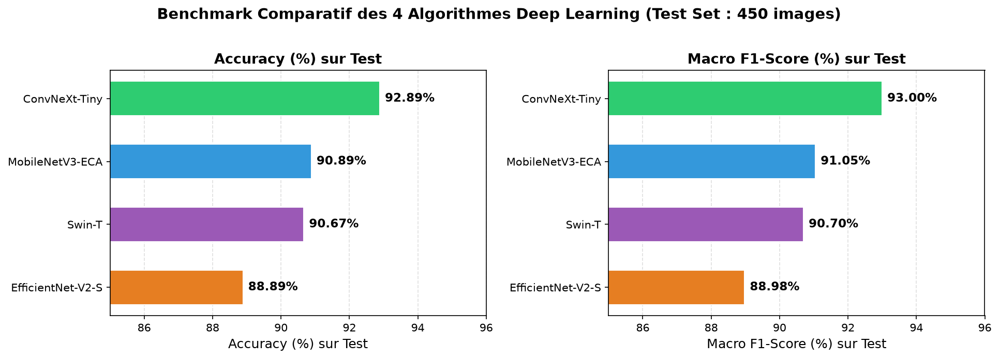

---

### Analyse Détaillée des Performances par Classe — ConvNeXt-Tiny

| Classe Sanitaire | Précision | Rappel | F1-Score | Support (Test) |
|:-----------------|:---------:|:------:|:--------:|:--------------:|
| **Healthy (Saine)** | **0.9836** | **1.0000** | **0.9917** | 120 |
| **Bug (Insectes seuls)** | **0.9271** | **0.9889** | **0.9570** | 90 |
| **Honey (Miellat)** | 0.9123 | 0.8667 | 0.8889 | 120 |
| **Mixed (Infestation mixte)** | 0.8898 | 0.8750 | 0.8824 | 120 |
| **Moyenne Macro (Global)** | **0.9282** | **0.9326** | **0.9300** | **450** |

> [!TIP]
> **Interprétation agronomique des métriques** :
> 1. **100 % de rappel sur les palmes saines** : Zéro faux positif, évitant tout traitement phytosanitaire inutile.
> 2. **98.89 % de rappel sur les insectes seuls** : Détection ultra-précoce des foyers d'adultes Dubas avant la ponte larvaire.
> 3. **Cohérence biologique** : Les rares confusions se situent entre *Honey* et *Mixed*, deux états biologiquement voisins caractérisés par des dépôts de miellat.

---

## 7. Galerie des Matrices de Confusion et Performances

### Grille Comparative des 4 Algorithmes Deep Learning

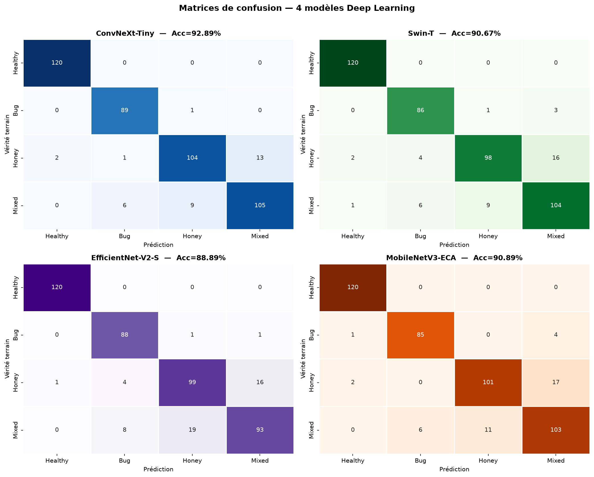

---

### ConvNeXt-Tiny (Champion — 92.89 %)

| Matrice de Confusion | Métriques par Classe |
|:---:|:---:|
| 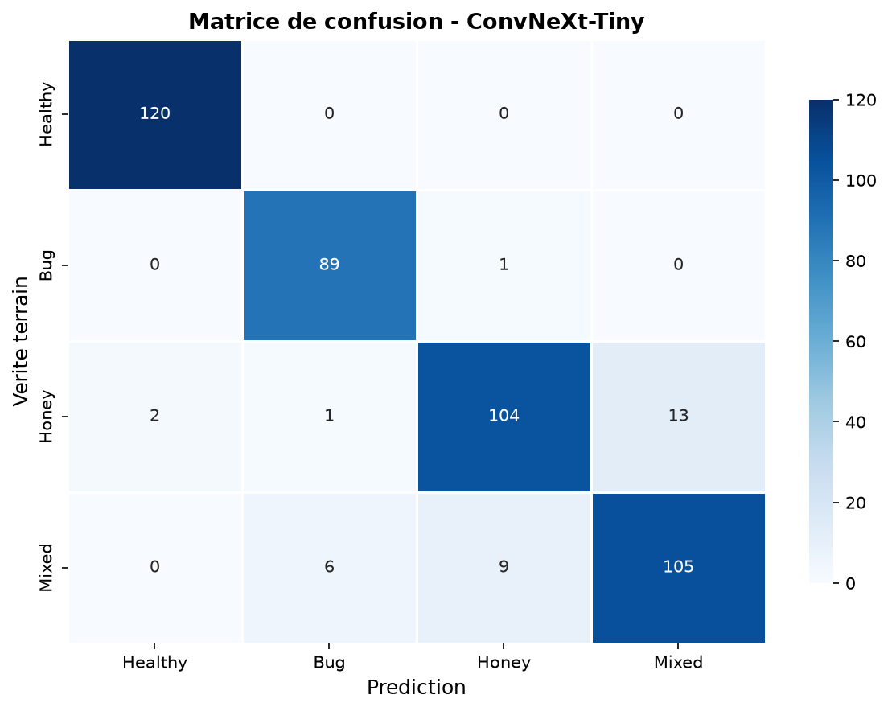 | 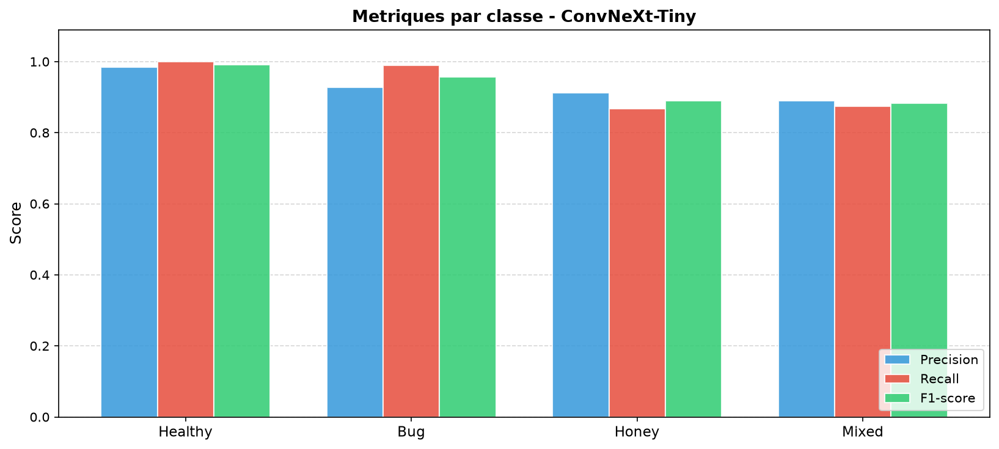 |

---

### MobileNetV3-ECA (Second — 90.89 %)

| Matrice de Confusion | Métriques par Classe |
|:---:|:---:|
| 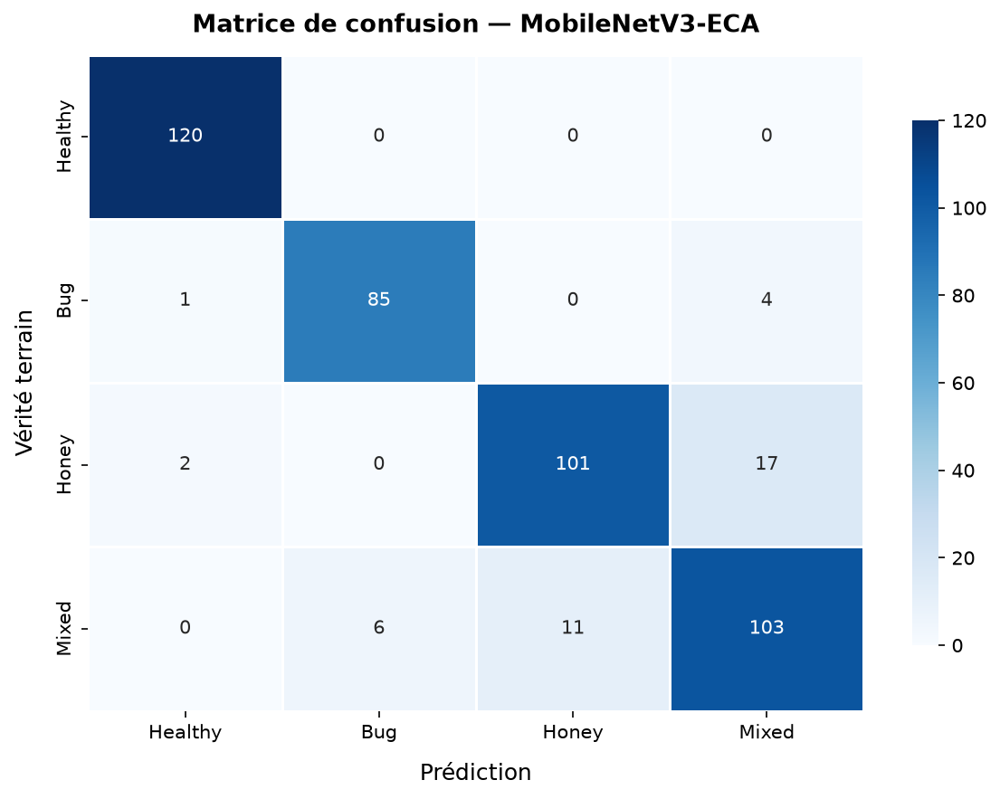 | 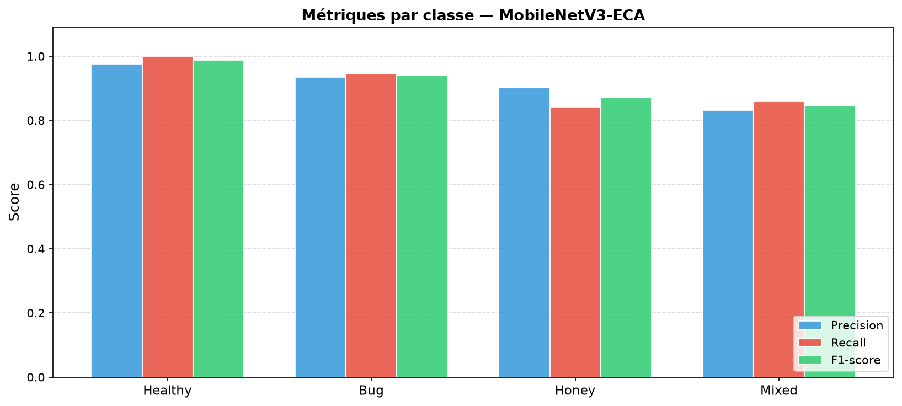 |

---

### Swin Transformer - Tiny (Troisième — 90.67 %)

| Matrice de Confusion | Métriques par Classe |
|:---:|:---:|
| 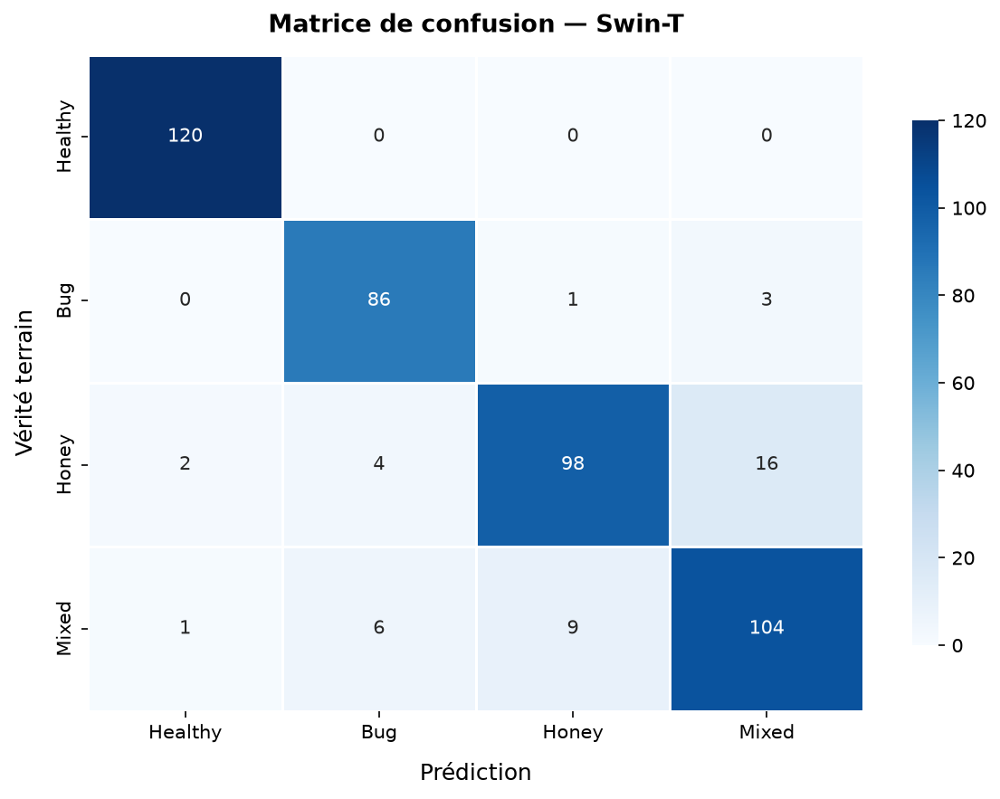 | 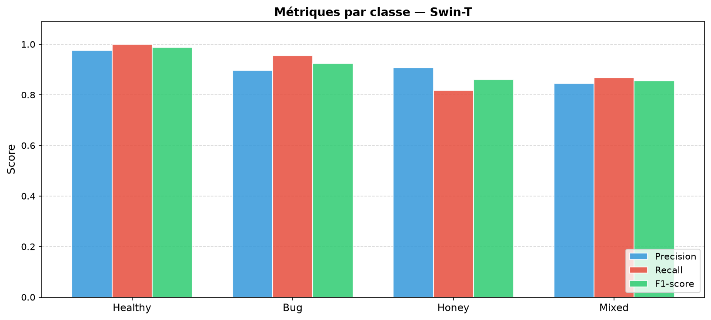 |

---

### EfficientNet-V2-S (Quatrième — 88.89 %)

| Matrice de Confusion | Métriques par Classe |
|:---:|:---:|
| 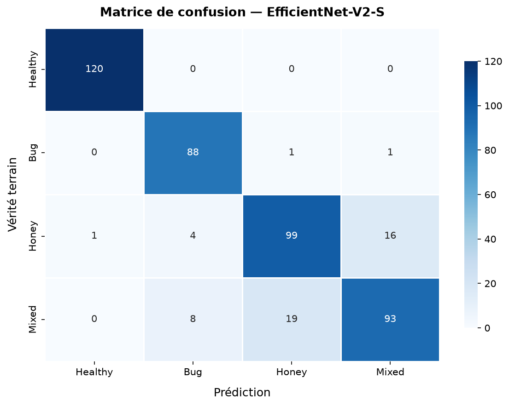 | 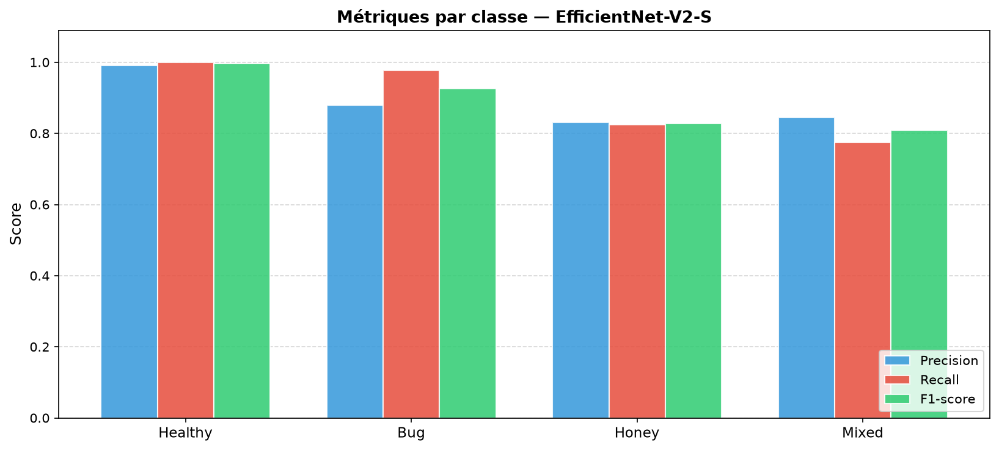 |

---

## 8. Organisation des Dossiers Générés

Chaque modèle possède son sous-dossier dédié dans `generation/` :

| Répertoire | Fichiers Générés | Rôle |
|:---|:---|:---|
| `generation/benchmark/` | `benchmark_global.png`, `benchmark_global.csv`, `confusion_matrices_combined.png`, `dataset_distribution.png`, `dataset_samples.png` | Graphiques de synthèse et données globales |
| `generation/ConvNeXt-Tiny/` | `confusion_matrix.png`, `per_class_metrics.png`, `resultats.csv` | Résultats détaillés du champion |
| `generation/MobileNetV3-ECA/` | `confusion_matrix.png`, `per_class_metrics.png`, `resultats.csv` | Résultats du modèle léger Edge-AI |
| `generation/Swin-T/` | `confusion_matrix.png`, `per_class_metrics.png`, `resultats.csv` | Résultats du Vision Transformer |
| `generation/EfficientNet-V2-S/` | `confusion_matrix.png`, `per_class_metrics.png`, `resultats.csv` | Résultats du CNN multi-échelle |

---

## 9. Guide d'Installation et Déploiement

### Prérequis Système

- Python : **3.10 ou 3.11**
- Mémoire vive : 4 Go RAM minimum

### 1. Installation des Dépendances

```bash
# Cloner le dépôt
git clone https://github.com/MalakBenSlim/projet-ML.git
cd projet-ML

# Installer les bibliothèques requises
pip install -r requirements.txt
```

### 2. Lancement des Applications

- **Interface Web Interactive (Streamlit)** :
  ```bash
  # Double-clic sous Windows sur :
  lancer_interface.bat

  # Ou en console :
  streamlit run app_streamlit.py
  ```
  Permet de tester n'importe quelle photo foliaire, de basculer entre les 4 modèles Deep Learning et d'obtenir le diagnostic et les recommandations en temps réel.

- **Interface Desktop Locale (Tkinter)** :
  ```bash
  # Double-clic sous Windows sur :
  lancer_interface_desktop.bat
  ```

### 3. Régénération Complète des Résultats

Pour réévaluer automatiquement les 4 modèles et régénérer tous les graphiques et CSV :

```bash
python generate_all_outputs.py
```

---

## 10. Références Scientifiques

```bibtex
@article{liu2022convnet,
  title   = {A ConvNet for the 2020s},
  author  = {Liu, Zhuang and Mao, Hanzi and Wu, Chao-Yuan and Feichtenhofer, Christoph and Darrell, Trevor and Xie, Saining},
  journal = {Proceedings of the IEEE/CVF Conference on Computer Vision and Pattern Recognition (CVPR)},
  pages   = {11976--11986},
  year    = {2022}
}

@article{howard2019searching,
  title   = {Searching for MobileNetV3},
  author  = {Howard, Andrew and Sandler, Mark and Chu, Grace and Chen, Liang-Chieh and Chen, Bo and Tan, Mingxing and Wang, Weijun and Zhu, Yukun and Pang, Ruoming and Vasudevan, Vijay and Le, Quoc V. and Adam, Hartwig},
  journal = {IEEE/CVF International Conference on Computer Vision (ICCV)},
  year    = {2019}
}

@article{liu2021swin,
  title   = {Swin Transformer: Hierarchical Vision Transformer using Shifted Windows},
  author  = {Liu, Ze and Lin, Yutong and Cao, Yue and Hu, Han and Wei, Yixiang and Zhang, Zheng and Lin, Stephen and Guo, Baining},
  journal = {IEEE/CVF International Conference on Computer Vision (ICCV)},
  pages   = {10012--10022},
  year    = {2021}
}

@article{tan2021efficientnetv2,
  title   = {EfficientNetV2: Smaller Models and Faster Training},
  author  = {Tan, Mingxing and Le, Quoc V.},
  journal = {International Conference on Machine Learning (ICML)},
  year    = {2021}
}
```

---

<div align="center">

**Projet de Diagnostic Phytosanitaire du Palmier Dattier par Deep Learning**  
*Vision Artificielle Appliquée à l'Agronomie Oasienne*

[](https://github.com/MalakBenSlim/projet-ML)

</div>
